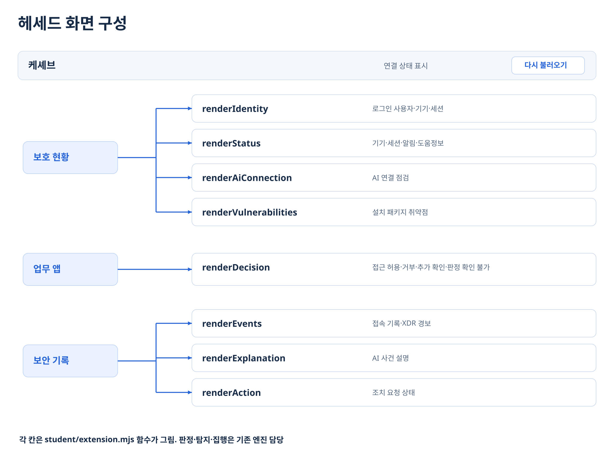
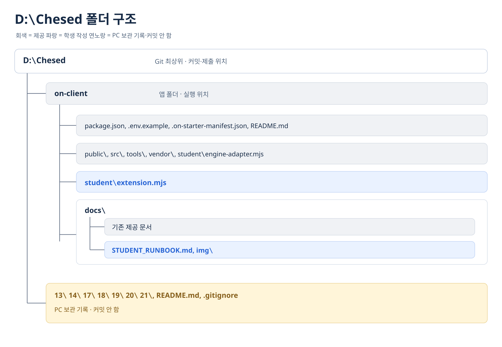
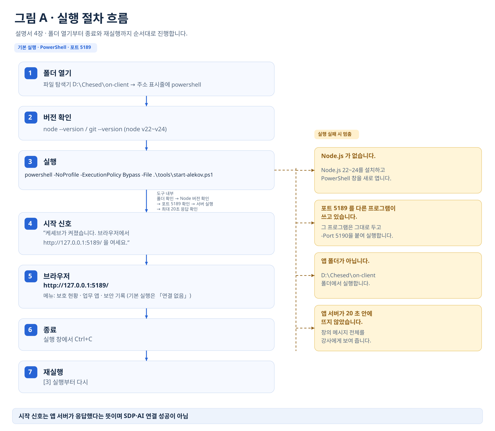
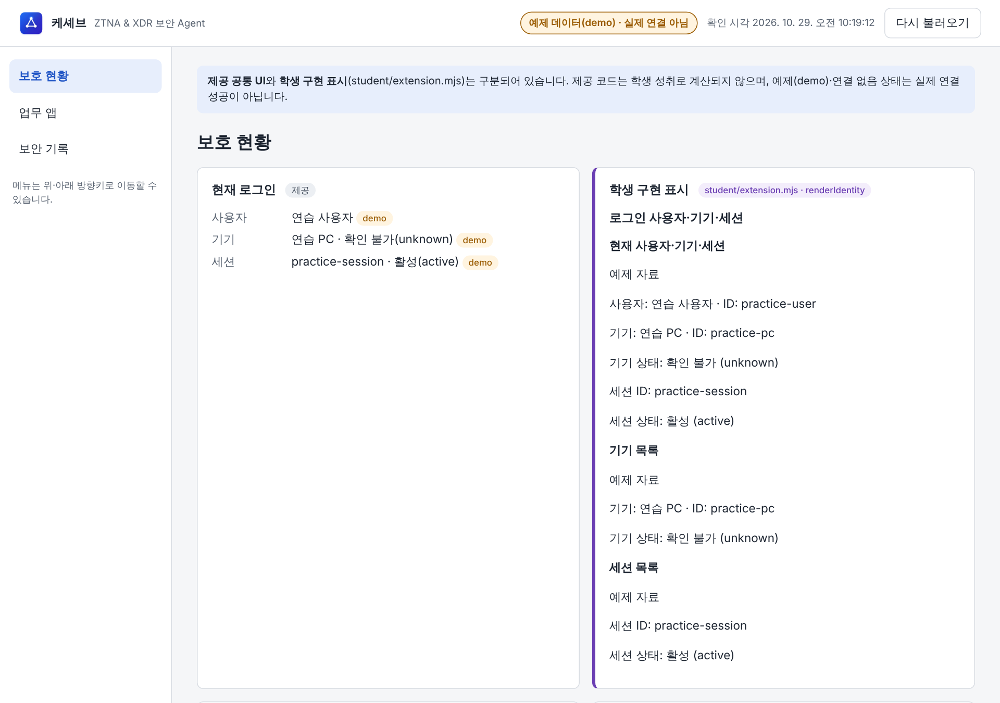
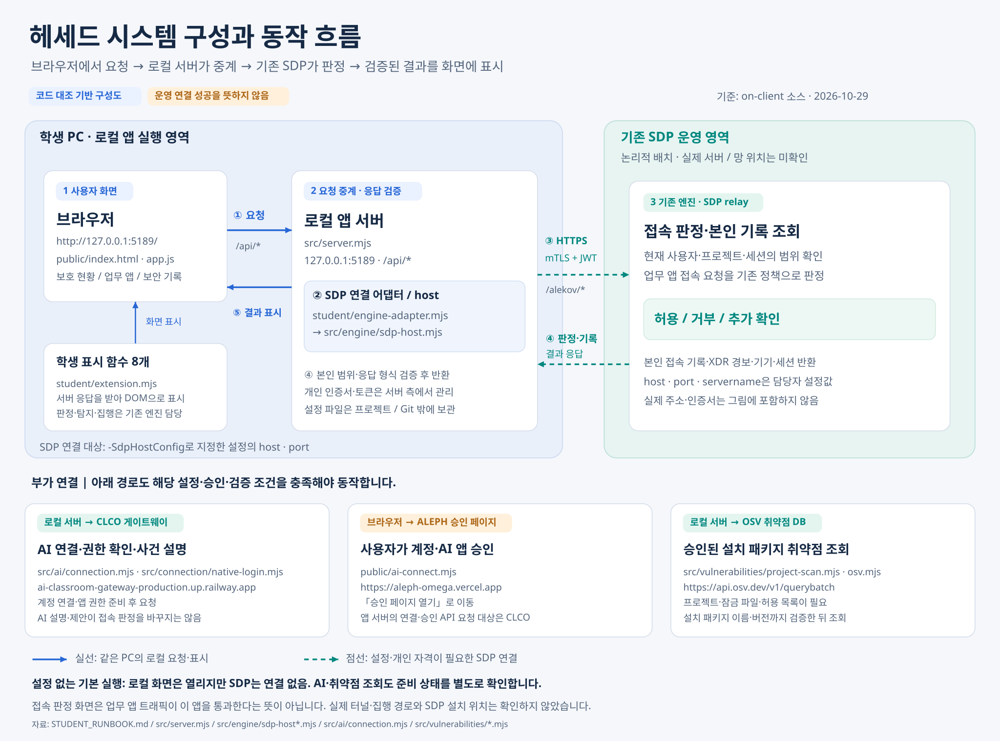
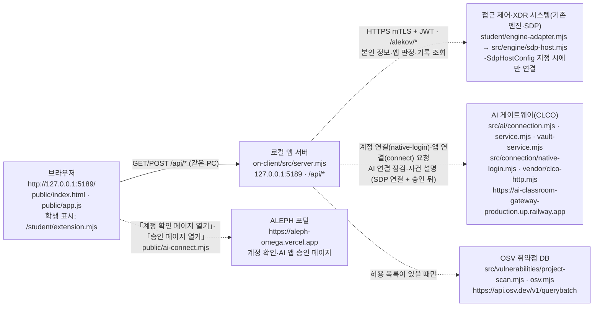
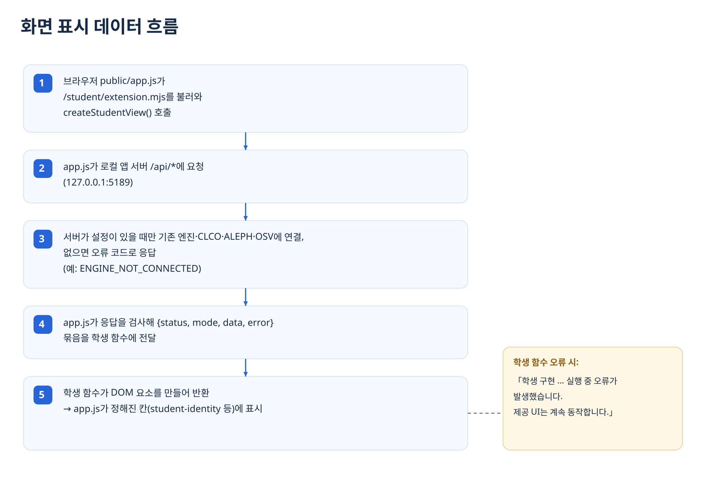
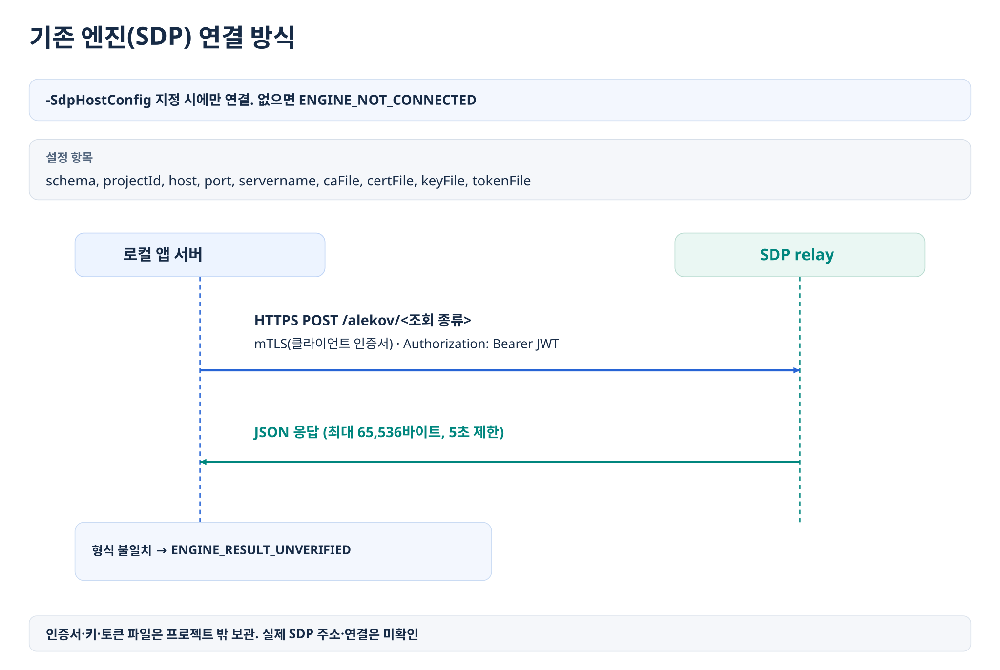
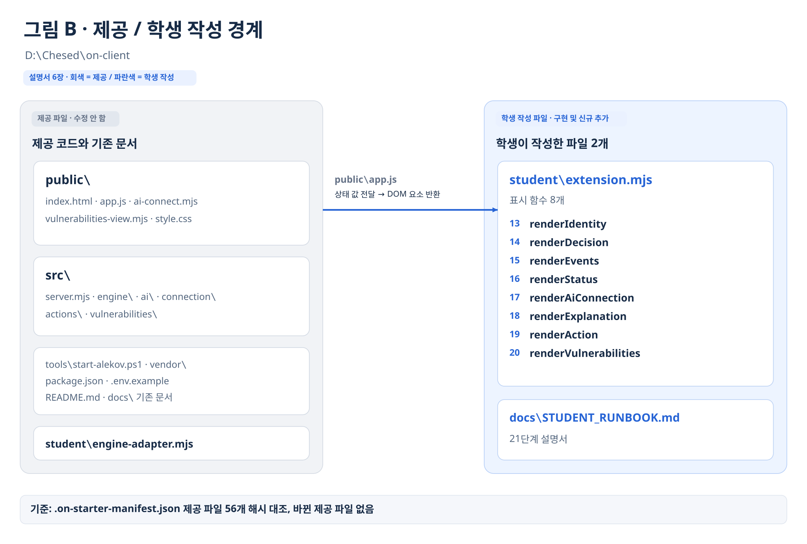
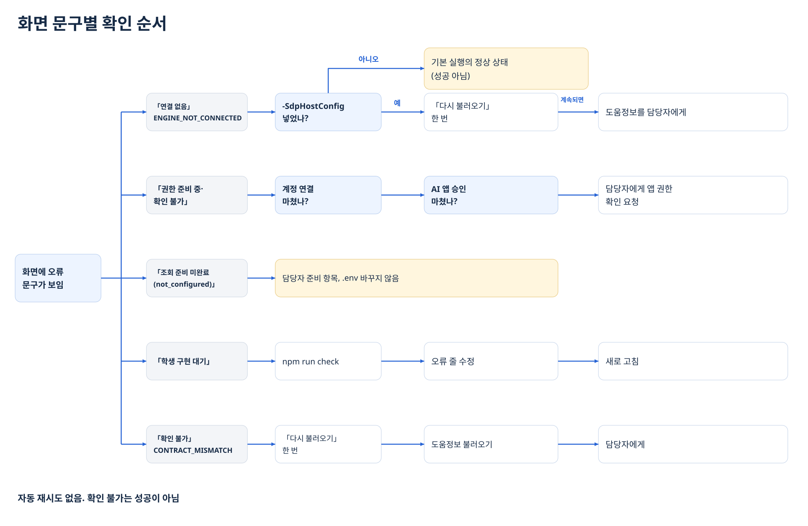

# 헤세드 학생용 실행 설명서와 시스템 구성도 (21단계)

이 문서는 학생이 직접 쓴 설명서입니다. 제공 문서(`README.md`, `docs/` 아래 기존 문서)는 고치지 않았으며, 이 파일만 새로 추가했습니다. 다른 사람이 이 문서만 보고 실제 작업 위치에서 앱을 켜고, 끄고, 다시 켜고, 문제가 생겼을 때 어디를 확인할지 알 수 있게 쓰는 것이 목표입니다.

- 보안 Agent 이름: **헤세드** (시작 틀의 기본 앱 이름은 **케셰브**이며, 실행 창·브라우저 제목에는 케셰브로 표시됩니다)
- 기준 소스: 시작 틀 `alekov-client-starter` 0.2.11 + 학생 구현 13~20단계(커밋 `84fbcf96e53cc9c0a697fed6b142a75ea8e0a098`, 「보안 Agent 20단계」) + 이 문서
- 작성일: 2026-10-29

### 확인 표기

이 문서의 모든 항목에는 어떻게 확인했는지를 함께 적습니다. 확인하지 않은 것을 확인했다고 쓰지 않습니다.

| 표기 | 뜻 |
| --- | --- |
| **[코드 확인]** | 저장소의 파일을 직접 읽고 대조했습니다. 실행은 하지 않았습니다. |
| **[작업 공간 실행]** | 같은 커밋의 사본을 별도 작업 공간(Linux, Node.js v22.23.4)에서 실행해 확인했습니다. 학생 PC(Windows)에서 한 확인이 아닙니다. |
| **[모의 데이터 점검]** | 단계별(13~20단계) 가짜 입력으로 학생 함수만 호출해 표시를 확인했습니다. 서버·실제 화면 확인이 아닙니다. |
| **[PC 확인 필요]** | 학생 PC에서 아직 실행해 보지 않았습니다. 「9. 직접 확인할 순서」에서 확인한 뒤 결과를 적습니다. |
| **미확인(UNV)** | 실제 연결·권한이 없어 지금은 확인할 수 없습니다. 성공으로 보지 않습니다. |

### 그림 목록

그림은 이해를 돕는 보조 자료이고, 판단 기준은 각 그림 옆의 글·표입니다. 그림만 있고 글이 없는 내용은 없습니다.

| 번호 | 제목 | 위치 | 파일 (`docs/img/`) |
| --- | --- | --- | --- |
| 그림 1 | 헤세드 화면 구성 | 1장 | `hesed-screen-layout.svg` |
| 그림 2 | D:\Chesed 폴더 구조 | 3장 | `hesed-folder-structure.svg` |
| 그림 3 | 실행 절차 흐름 | 4장 | `hesed-execution-flow.svg` |
| 화면 1 | 예제 모드 첫 화면 (캡처) | 4-5 | `hesed-demo-screen.png` |
| 그림 4 | 헤세드 시스템 구성과 동작 흐름 | 5장 | `hesed-system-architecture.svg` |
| 그림 5 | 화면 표시 데이터 흐름 | 5-4 | `hesed-display-data-flow.svg` |
| 그림 6 | 기존 엔진(SDP) 연결 방식 | 5-5 | `hesed-sdp-connection-sequence.svg` |
| 그림 7 | 제공 / 학생 작성 경계 | 6장 | `hesed-provided-student-boundary.svg` |
| 그림 8 | 화면 문구별 확인 순서 | 7장 | `hesed-troubleshooting-flow.svg` |

각 SVG와 같은 이름의 PNG도 함께 있습니다.

---

## 1. 목적과 기능

헤세드(케셰브)는 회사 직원이 **자기** 로그인 상태, 업무 앱 접속 판정, 최근 접속 기록·XDR 경보, AI 사건 설명, 조치 요청 상태, 설치 패키지 취약점 조회 결과를 보는 ZTNA·XDR 보안 Agent 앱입니다. 내 PC에서 실행하며, 판정·탐지·집행은 앱이 스스로 하지 않고 기존 엔진(SDP 서버)의 결과를 보여 줍니다. **[코드 확인]** `README.md`, `docs/FINAL_PRODUCT_GUIDE.md`

화면은 세 메뉴로 나뉩니다. **[작업 공간 실행]** 왼쪽 세로 메뉴(주 메뉴)에 「보호 현황」「업무 앱」「보안 기록」 세 개가 보였습니다. 위쪽 막대에는 앱 이름, 연결 상태 표시, 「다시 불러오기」 버튼이 있습니다.

| 메뉴 | 보는 것 | 학생이 만든 표시 칸 |
| --- | --- | --- |
| 보호 현황 | 로그인 사용자·기기·세션, 알림, 도움정보, 계정 연결 확인, AI 연결, 설치 패키지 취약점 조회 | `renderIdentity`, `renderStatus`, `renderAiConnection`, `renderVulnerabilities` |
| 업무 앱 | 앱별 접속 요청과 판정(허용·거부·추가 확인·확인 불가) | `renderDecision` |
| 보안 기록 | 내 접속 기록·XDR 경보 목록과 상세, AI 사건 설명, 조치 요청 상태 | `renderEvents`, `renderExplanation`, `renderAction` |



**그림 1 · 헤세드 화면 구성** — 위 표(메뉴 3개와 학생 표시 함수 8개)를 그림으로 옮긴 것입니다. (PNG: `img/hesed-screen-layout.png`)

---

## 2. 지원 환경과 버전

| 항목 | 요구 조건 (근거) | 실제로 확인한 버전 |
| --- | --- | --- |
| 운영체제 | Windows. 실행 도구가 PowerShell 스크립트이고 Windows 절대 경로(`D:\...`)를 검사합니다. **[코드 확인]** `tools/start-alekov.ps1` | 학생 PC: Windows. 세부 버전 **[PC 확인 필요]** `winver` |
| PowerShell | `powershell -NoProfile -ExecutionPolicy Bypass -File ...` 형식으로 실행합니다. 이 명령은 Windows PowerShell 5.1을 실행하며, 스크립트가 `::new()` 문법을 쓰므로 5.0 미만에서는 실행되지 않습니다. PowerShell 7(`pwsh`)은 확인하지 않았습니다. **[코드 확인]** | **[PC 확인 필요]** `$PSVersionTable.PSVersion` |
| Node.js | 실행 도구는 **22~24**만 허용하고, 24.19.0이 아니면 「참고: 지금 Node.js 는 …」 안내를 출력합니다. `package.json`의 `engines.node`는 `24.19.0`입니다. 단, 서버가 시작할 때 `node:sqlite`를 불러오므로(`src/actions/store.mjs`) Node.js 22의 초기 버전(22.13 미만으로 추정)에서는 실행 도구를 통과해도 서버가 시작하지 못할 수 있습니다. **[코드 확인]** | 학생 PC **[PC 확인 필요]** `node --version` / 작업 공간 v22.23.4 **[작업 공간 실행]** |
| npm 의존성 | 없음. `package.json`에 `dependencies`가 없고, 저장소에 `package-lock.json`이 없습니다. `npm install`을 하지 않습니다. **[코드 확인]** | 해당 없음 |
| Git | 커밋·제출에 사용합니다. Git 최상위는 `D:\Chesed`입니다. **[코드 확인]** `.git`, `0커밋.txt` | **[PC 확인 필요]** `git --version` |
| 브라우저 | PC 브라우저로 `http://127.0.0.1:5189/`를 엽니다. 서버는 `127.0.0.1`에만 열립니다. `http://localhost:5189/`도 열리지만, PC의 IP 주소나 다른 이름으로 접속하면 `HOST_REJECTED`(403), 주소 뒤에 `?…`를 붙이면 `QUERY_REJECTED`(400)로 거절됩니다. **[코드 확인]** `src/server.mjs` `server.listen(port,'127.0.0.1')`, `allowedHosts` | 작업 공간 Chromium(Playwright)으로 화면 확인 **[작업 공간 실행]** |
| 시작 틀 버전 | `package.json` `version` = `0.2.11` **[코드 확인]** | API 응답의 `meta.starterVersion`은 `0.1.0`으로 나왔습니다 **[작업 공간 실행]**. 두 값이 다르며 제공 서버의 표시값이므로 수정하지 않았습니다. |

지원하지 않거나 확인하지 않은 환경: macOS·Linux에서의 `start-alekov.ps1` 실행, Node.js 21 이하·25 이상(실행 도구가 거부), Node.js 22 초기 버전, PowerShell 7(`pwsh`), 외부 PC에서 원격 접속(서버가 127.0.0.1에만 열림), Chromium 외 브라우저. 이 환경에서 된다고 적지 않습니다. Linux에서 `node src/server.mjs`를 직접 실행한 것은 작업 공간에서 동작을 확인했지만 지원 환경으로 보장하지 않습니다.

---

## 3. 폴더 구조

**[코드 확인]** 실제 학생 PC 경로 기준입니다.



**그림 2 · D:\Chesed 폴더 구조** — 아래 폴더 트리를 그림으로 옮긴 것입니다. 회색은 제공, 파랑은 학생 작성, 연노랑은 PC 보관 기록입니다. (PNG: `img/hesed-folder-structure.png`)

```text
D:\Chesed\                         ← 프로젝트 폴더 = Git 최상위 (커밋·제출은 여기서)
├─ .git\
├─ on-client\                      ← 앱 폴더 (실행은 여기서)
│  ├─ package.json                 시작 틀 이름·버전·npm 스크립트 (제공)
│  ├─ .env.example                 비밀 없는 설정 견본 (제공)
│  ├─ .on-starter-manifest.json    제공 파일 목록과 해시 (제공)
│  ├─ README.md                    제공 안내 (제공, 수정 안 함)
│  ├─ docs\                        제공 문서 + 학생 문서(STUDENT_RUNBOOK.md, img\ 그림)
│  ├─ public\                      브라우저 화면 (제공: index.html, app.js, ai-connect.mjs, vulnerabilities-view.mjs, style.css, assets)
│  ├─ src\                         로컬 앱 서버 (제공: server.mjs, engine.mjs, actions\, ai\, connection\, engine\, learner-support\, vulnerabilities\)
│  ├─ student\
│  │  ├─ extension.mjs             ← 학생 구현 파일 (13~20단계)
│  │  └─ engine-adapter.mjs        기존 엔진 연결 어댑터 (제공, 수정 안 함)
│  ├─ tools\                       실행 도구 (제공: start-alekov.ps1 등)
│  └─ vendor\                      제공 HTTP 모듈 (clco-http.mjs)
├─ 13\ 14\ 17\ 18\ 19\ 20\ 21\     단계 작업 기록 (PC 보관용)
└─ README.md, .gitignore, 0*.txt  작업 기록·메모 (PC 보관용)
```

단계 기록·루트 `README.md`·`.gitignore`는 지금까지 커밋하지 않았습니다. 다만 `D:\Chesed\.gitignore`는 이 폴더들을 제외하지 않으므로(`!/13/` 등 허용 규칙), `git add -A`를 쓰면 함께 들어갑니다. 커밋할 때는 `on-client/` 안의 파일만 지정해서 추가합니다. **[코드 확인]** `D:\Chesed\.gitignore`

---

## 4. 실행 절차



**그림 3 · 실행 절차 흐름** — 아래 4-1~4-7과 7-1의 주요 실행 도구 메시지 4개를 한 장으로 정리한 것입니다. (PNG: `img/hesed-execution-flow.png`)

### 4-1. PowerShell을 여는 위치

1. 파일 탐색기에서 `D:\Chesed\on-client` 폴더를 엽니다.
2. 주소 표시줄에 `powershell`을 입력하고 Enter를 누릅니다.
3. 열린 창의 프롬프트가 `PS D:\Chesed\on-client>`인지 확인합니다.

또는 아무 PowerShell 창에서 먼저 이동합니다.

```powershell
cd D:\Chesed\on-client
```

실행 도구는 자기 위치(`tools`)의 상위 폴더를 앱 폴더로 보고 `src\server.mjs`와 `package.json`(name이 `alekov-client-starter`)이 있는지 검사합니다. 이 검사는 현재 폴더가 아니라 **스크립트 파일 자신의 위치**(`$PSScriptRoot`)를 기준으로 합니다. 다만 이 문서의 명령은 `.\tools\start-alekov.ps1` 상대 경로이므로, 현재 폴더가 `D:\Chesed\on-client`가 아니면 PowerShell이 파일을 찾지 못해 도구가 아예 시작되지 않습니다(이때 나오는 PowerShell 자체 오류 문구는 확인하지 않았습니다). 「앱 폴더가 아닙니다」·「시작 틀 폴더가 아닙니다」는 스크립트가 시작 틀 밖으로 옮겨졌거나 `package.json`의 name이 다를 때 나옵니다. **[코드 확인]** `tools/start-alekov.ps1` 36~45행

### 4-2. 실행 전 버전 확인 (새 PowerShell 창)

```powershell
node --version
git --version
$PSVersionTable.PSVersion
```

`node --version`이 v22~v24여야 합니다. 결과는 「2. 지원 환경과 버전」 표에 직접 적습니다. **[PC 확인 필요]**

### 4-3. 실행 명령

```powershell
powershell -NoProfile -ExecutionPolicy Bypass -File .\tools\start-alekov.ps1
```

- `-ExecutionPolicy Bypass`는 이 한 번의 실행에만 적용되며 PC 설정을 바꾸지 않습니다. **[코드 확인]** 스크립트 머리말
- 실행 도구가 하는 일 **[코드 확인]**: ① 앱 폴더 확인 → ② (옵션을 준 경우) 설정 파일 경로 검사·`-Demo`와 `-SdpHostConfig` 동시 사용 거부 → ③ Node.js 버전 확인(22~24) → ④ 포트 5189 사용 여부 확인 → ⑤ 비밀처럼 보이는 환경변수(TOKEN·SECRET·PASSWORD·API_KEY·`ON_AI_*` 등)를 지우고 `node src\server.mjs` 직접 실행 → ⑥ 최대 20초 동안 `http://127.0.0.1:5189/`가 200으로 응답하는지 확인
- 프로그램 설치, 실행 정책 변경, 다른 프로그램 종료는 하지 않습니다. **[코드 확인]**

선택 옵션 (실행 도구에 실제로 있는 것만) **[코드 확인]** `param(...)`:

| 옵션 | 뜻 |
| --- | --- |
| `-Port 5190` | 5189를 다른 프로그램이 쓸 때. 1024~65535만 허용. 브라우저 주소도 같은 포트로 엽니다 |
| `-Background` | 창 없이 실행. 안내된 프로세스 번호의 node를 작업 관리자에서 종료 |
| `-Demo` | 예제 자료로 실행. 실제 연결이 아닙니다. `-SdpHostConfig`와 함께 쓸 수 없습니다 |
| `-NativeHostConfig "<담당자가 안내한 절대 경로>"` | 계정 연결·AI 앱 승인용 설정. 담당자 안내가 있을 때만 |
| `-SdpHostConfig "<담당자가 안내한 절대 경로>"` | 기존 접속·XDR 서버(SDP) 연결 설정. 담당자 안내가 있을 때만 |
| `-WaitSeconds 30` | 켜짐 확인 대기 시간(1~120초, 기본 20) |

설정 파일·인증서는 `D:\Chesed` 밖(Git·제출물 밖)에 둡니다. SDP 설정 파일과 인증서·키·토큰을 앱 폴더(`on-client`) 안에 두면 서버가 시작하지 않습니다(5-5 참고). 이 문서에는 설정 파일의 실제 경로와 내용을 적지 않습니다.

다른 실행 방법 (앱 폴더에서) **[코드 확인]** `package.json` `scripts`:

| 명령 | 실제 실행 내용 | 비고 |
| --- | --- | --- |
| `npm start` | `node src/server.mjs` | 실행 도구의 버전·포트 사전 확인이 없습니다. 또 실행 도구와 달리 `ON_AI_*` 같은 환경변수를 지우지 않고 그대로 서버에 넘깁니다 |
| `npm run demo` | `node src/server.mjs --demo` | 예제 자료. 실제 연결 아님 |
| `npm run check` | `node --check student/extension.mjs` | 학생 파일 문법만 확인 |

### 4-4. 정상 시작 신호

실행 도구를 쓴 경우 PowerShell 창에 아래 세 줄이 나오면 서버가 응답한 것입니다. `-Background`로 실행하면 셋째 줄 대신 「뒤에서 실행 중입니다(프로세스 번호 …). 끄려면 이 번호의 node 를 작업 관리자에서 종료하세요.」가 나옵니다. **[코드 확인]** `start-alekov.ps1` 5) 부분 / **[PC 확인 필요]**

```text
케셰브가 켜졌습니다. 브라우저에서 http://127.0.0.1:5189/ 을 여세요.
서버가 응답한 것만 확인했습니다. AI 연결 상태는 화면에서 따로 확인해 주세요.
끄려면 이 창에서 Ctrl+C 를 누르세요.
```

Node.js가 v24.19.0이 아니면 그 앞에 「참고: 지금 Node.js 는 vX.Y.Z 입니다. 수업 기준은 v24.19.0 입니다.」가 먼저 나옵니다. 서버 자체도 같은 창에 `케셰브 연결 확인: http://127.0.0.1:5189`(예제 모드는 `케셰브 예제: …`)를 출력합니다(실행 도구 메시지와의 줄 순서는 확인하지 않았습니다. `-Background`에서는 node가 창 없이 실행되어 이 줄이 보이지 않습니다). **[코드 확인]** `src/server.mjs` / **[작업 공간 실행]** `node src/server.mjs`로 실행했을 때 이 줄이 출력됐습니다. (작업 공간의 Node.js 22에서는 SQLite 실험 기능 경고 1줄도 함께 나왔습니다.)

이 신호는 **내 PC의 앱 서버가 응답했다는 뜻일 뿐**입니다. 계정 연결·SDP 연결·AI 연결 성공을 뜻하지 않습니다.

### 4-5. 브라우저 주소와 첫 화면



**화면 1 · 예제 모드 첫 화면 (보호 현황)** — 이 캡처는 **예제 모드**로 찍은 것입니다. 이 프로젝트에는 담당자가 발급하는 기존 엔진(SDP) 연결 설정(`-SdpHostConfig`)이 제공되지 않아, 기본 실행에서는 SDP에 연결할 수 없고 「연결 없음」 오류 화면만 나옵니다. 그래서 화면 구성과 학생 구현 표시를 보이기 위해 제공 예제 데이터로 실행해 캡처했습니다. 2026-10-29 작업 공간(Linux, Node.js v22.23.4)에서 같은 커밋 사본을 `node src/server.mjs --demo`(포트 5189, `npm run demo`와 같음)로 실행하고 Chromium으로 캡처했습니다. **학생 PC 캡처가 아니며, 실제 연결 화면도 아닙니다.** 위쪽에 「예제 데이터(demo) · 실제 연결 아님」이 표시되고, 값은 제공 예제(`src/engine.mjs` `demoEngine`)의 연습 사용자·연습 PC·practice-session입니다. 오른쪽 학생 구현 칸(`renderIdentity`)은 「예제 자료」로 같은 값을 표시합니다. PC에서 `-Demo` 옵션으로 실행하면 같은 화면이 나와야 합니다 **[PC 확인 필요]**.

설정 없이 기본 실행하면 아래 목록처럼 「연결 없음」 화면이 나옵니다.

- 주소: `http://127.0.0.1:5189/` (포트를 바꿨으면 그 번호)
- 기본 실행(설정 파일 없음)에서 보이는 것 **[작업 공간 실행]**:
  - 왼쪽 메뉴: 「보호 현황」「업무 앱」「보안 기록」 / 위쪽 막대: 「연결 없음」 표시, 「다시 불러오기」
  - 로그인 사용자·기기·세션 칸: 「연결 없음」, 「연결 실패 또는 확인 불가: 기존 서버·에이전트의 연결을 확인할 수 없습니다. 연결 어댑터를 먼저 확인하세요.」
  - 설치 패키지 칸: 「조회 전(idle)」
  - AI 연결 점검 칸: 「AI 연결 점검 전」
  - 브라우저 페이지 실행 오류: 0건
- 위 상태는 **정상 실행이지만 연결 없음 상태**입니다. 연결 성공이 아닙니다.

### 4-6. 종료

- 실행 창에서 `Ctrl+C`를 누릅니다. **[코드 확인]**
- `-Background`로 켰다면 안내된 프로세스 번호의 `node`를 작업 관리자에서 종료합니다. **[코드 확인]** PowerShell에서는 `Stop-Process -Id <안내된 번호>`로도 끌 수 있습니다. **[PC 확인 필요]**
- 브라우저에서 주소를 새로 고쳐 더 이상 열리지 않으면 꺼진 것입니다. **[PC 확인 필요]**

### 4-7. 재실행 순서

1. 이전 서버가 꺼졌는지 확인합니다(4-6).
2. 같은 폴더 `D:\Chesed\on-client`에서 4-3 명령을 다시 실행합니다.
3. 「포트 5189 를 다른 프로그램이 쓰고 있습니다」가 나오면 이전 node가 아직 켜져 있는지 먼저 확인하고, 그 프로그램을 끌 수 없으면 `-Port 5190`으로 실행합니다.
4. 브라우저에서 주소를 다시 열고 위쪽 「다시 불러오기」를 누릅니다.

실행과 종료는 프로젝트 파일을 바꾸지 않습니다. **[코드 확인]** 실행 도구는 파일을 쓰지 않고, 서버도 기본·예제 실행에서는 조치 DB를 열지 않습니다(`--alekov-actions` 설정이 있을 때만 엶, `src/server.mjs`).

---

## 5. 시스템 구성도



**그림 4 · 헤세드 시스템 구성과 동작 흐름** (PNG: `img/hesed-system-architecture.png`) — 같은 내용을 아래 Mermaid(글로 쓴 구성도), ASCII, 표, 5-5 SDP 연결 방식으로 적었습니다. 그림만으로 판단하지 않도록 글 내용이 기준입니다. 주소는 코드에 들어 있는 공개 주소만 적었습니다.

### 5-1. Mermaid



실선은 같은 PC 안의 기본 경로(브라우저 ↔ 로컬 앱 서버), 점선은 담당자 설정·승인이 있어야 열리는 경로입니다. 기존 엔진(SDP) 연결도 `-SdpHostConfig`가 있어야 하므로 점선입니다. 기본 실행에서는 점선 경로가 모두 꺼져 있습니다. 앱 서버는 ALEPH 포털에 직접 요청하지 않습니다. ALEPH 주소는 승인 페이지 주소를 만들고 검사하는 데만 쓰이고, 그 페이지는 브라우저가 엽니다. **[코드 확인]** `src/connection/native-login.mjs`, `src/ai/connection.mjs`

### 5-2. ASCII

```text
[브라우저]  http://127.0.0.1:5189/
  public/index.html, public/app.js (제공 화면)
  /student/extension.mjs (학생 표시 함수 8개)
        ├──▶ [ALEPH 포털]  https://aleph-omega.vercel.app
        │      「계정 확인 페이지 열기」·「승인 페이지 열기」로 새 창을 엶 (서버를 거치지 않음)
        │
        │  fetch /api/me, /api/apps, /api/access, /api/events, /api/devices,
        │        /api/sessions, /api/diagnostics, /api/vulnerabilities,
        │        /api/ai/*, /api/native-login/*, /api/actions/*
        ▼
[로컬 앱 서버]  on-client/src/server.mjs  (127.0.0.1:5189, 이 PC에서만 접속)
        ├──▶ [접근 제어·XDR 시스템 = 기존 엔진/SDP]
        │      student/engine-adapter.mjs → src/engine/sdp-host.mjs
        │      HTTPS mTLS + JWT, 경로 /alekov/* (5-5 참고)
        │      -SdpHostConfig 없으면: ENGINE_NOT_CONNECTED (연결 없음)
        ├──▶ [AI 게이트웨이 = CLCO]
        │      src/ai/connection.mjs · service.mjs · vault-service.mjs
        │      src/connection/native-login.mjs · vendor/clco-http.mjs
        │      https://ai-classroom-gateway-production.up.railway.app
        │      계정 연결·앱 연결 요청, AI 점검·사건 설명 (서버가 직접 요청)
        │      SDP 연결 없음: AI 점검이 ENGINE_NOT_CONNECTED → 화면은 AI_REQUEST_UNVERIFIED
        │      SDP 연결 후 계정 연결·앱 승인 전: ON_AI_PROVISIONING_PENDING 등
        └──▶ [OSV]  src/vulnerabilities/project-scan.mjs · osv.mjs
               https://api.osv.dev/v1/querybatch
               ON_PROJECT_DIRECTORY 없으면 not_configured, 허용 목록이 비면 not_checked (외부 조회 안 함)
```

### 5-3. 표

| 상자 | 실제 파일 또는 주소 | 하는 일 | 하지 않는 일 | 확인 상태 |
| --- | --- | --- | --- | --- |
| 브라우저 | `http://127.0.0.1:5189/`, `public/index.html`, `public/app.js`, `/student/extension.mjs` | 화면 표시, 버튼 처리, `/api/*` 요청. 학생 함수에 받은 상태를 넘겨 표시 | 외부 시스템 API를 직접 호출하지 않음(ALEPH 페이지는 새 창으로 열기만 함). 학생 모듈은 허용된 GET 6개만 쓸 수 있음 | 첫 화면 표시 **[작업 공간 실행]**, PC **[PC 확인 필요]** |
| 로컬 앱 서버 | `on-client/src/server.mjs`, `127.0.0.1:5189` | 정적 파일 제공, `/api/*` 처리, 외부 연결 중계, 비밀값 보관·차단 | 다른 PC에서 접속 받지 않음(127.0.0.1) | `GET /` 200, `/student/extension.mjs` 200 **[작업 공간 실행]** |
| 접근 제어·XDR 시스템(기존 엔진·SDP) | `student/engine-adapter.mjs` → `src/engine/sdp-host.mjs`, 실행 옵션 `-SdpHostConfig` | 본인·기기·세션, 업무 앱 판정, 접속 기록·XDR 경보 | AI 결과로 판정을 바꾸지 않음 | 기본 실행에서 `/api/me`·`/api/apps`·`/api/events`가 `ENGINE_NOT_CONNECTED` **[작업 공간 실행]**. 실제 연결 **미확인(UNV)** |
| AI 게이트웨이(CLCO) | `src/ai/connection.mjs`의 `CLCO_GATEWAY_ORIGIN` = `https://ai-classroom-gateway-production.up.railway.app` | 계정 연결·앱 연결 요청 처리, AI 앱 권한·사용량 확인, 모델 연결 점검, 사건 설명(점검·설명은 SDP 연결이 있어야 함) | 원본 AI 공급사 열쇠를 앱에 주지 않음(제공 문서 `docs/FINAL_PRODUCT_GUIDE.md` 기준). 앱 전용 열쇠는 이 PC 앱 서버 보관함에 저장되고 브라우저로 내보내지 않음 | 기본 실행 `/api/diagnostics`에서 `ai.configured: false` **[작업 공간 실행]**. 실제 연결 **미확인(UNV)** |
| ALEPH 포털 | `src/ai/connection.mjs`의 `ALEPH_PORTAL_ORIGIN` = `https://aleph-omega.vercel.app` | 브라우저가 연 페이지에서 계정 확인 번호 확인과 AI 앱 승인 | 앱 서버가 직접 요청하지 않음 | **미확인(UNV)** |
| OSV | `src/vulnerabilities/osv.mjs`, `https://api.osv.dev/v1/querybatch` | 허용된 공개 패키지의 알려진 취약점 조회 | 허용 목록이 비어 있으면 외부 조회 0 | 기본 실행 `/api/vulnerabilities`가 `not_configured`·`PROJECT_NOT_CONFIGURED` **[작업 공간 실행]**. 실제 조회 **미확인(UNV)** |

### 5-4. 데이터 흐름 (글)



**그림 5 · 화면 표시 데이터 흐름** — 아래 1~5단계를 그림으로 옮긴 것입니다. (PNG: `img/hesed-display-data-flow.png`)

1. 브라우저의 `public/app.js`가 `/student/extension.mjs`를 불러와 `createStudentView()`를 호출합니다. **[코드 확인]** `app.js` `loadStudentModule`
2. `app.js`가 로컬 앱 서버의 `/api/*`에 요청합니다(127.0.0.1:5189). **[코드 확인]** `app.js` `request`
3. 서버는 실행 옵션(`-SdpHostConfig`·`-NativeHostConfig`)과 환경변수(`ON_PROJECT_DIRECTORY`·`ON_APPROVED_PUBLIC_PACKAGES`)가 있을 때만 기존 엔진(SDP)·CLCO·OSV에 연결하고, 없으면 오류 코드로 응답합니다(예: `ENGINE_NOT_CONNECTED`). ALEPH는 서버가 부르지 않습니다. **[코드 확인]** `src/server.mjs` 실행 진입부(파일 끝), `src/engine.mjs` `disconnected`
4. `app.js`가 응답을 검사해 상태 묶음(`status`·`mode`·`data`·`error` 등)을 만들어 학생 함수에 넘깁니다. **[코드 확인]** `app.js` `VALIDATORS`, `studentData`
5. 학생 함수가 DOM 요소를 만들어 돌려주면 `app.js`가 정해진 칸(`student-identity` 등)에 넣습니다. 학생 함수가 오류를 내면 「학생 구현 … 실행 중 오류가 발생했습니다. 제공 UI는 계속 동작합니다.」, 반환 값이 DOM 요소·텍스트가 아니면 「학생 구현 …의 반환 형식이 DOM 요소 또는 텍스트가 아닙니다.」로 표시합니다. **[코드 확인]** `app.js` `renderStudent`, `STUDENT_SLOTS`

### 5-5. 기존 엔진(SDP) 연결 방식

**[코드 확인]** `src/engine/sdp-host-config.mjs`, `src/engine/sdp-host.mjs`



**그림 6 · 기존 엔진(SDP) 연결 방식** — 아래 표를 그림으로 옮긴 것입니다. SDP 연결 설정이 제공되지 않아 실제 연결은 확인하지 못했습니다. (PNG: `img/hesed-sdp-connection-sequence.png`)

| 항목 | 내용 |
| --- | --- |
| 연결 조건 | 실행 옵션 `-SdpHostConfig "<담당자가 안내한 절대 경로>"`를 줄 때만 연결. 없으면 `ENGINE_NOT_CONNECTED` |
| 설정 항목 | 필수 `schema`(값 `alekov.sdp.host.v1`), `projectId`, `host`, `port`, `servername`, `caFile`, `certFile`, `keyFile`, `tokenFile` / 선택 `receiptPort` (값은 담당자 설정, 이 문서에 적지 않음) |
| 보관 위치 | 설정 파일과 caFile·certFile·keyFile·tokenFile이 앱 폴더(`on-client`) 안에 있으면 서버가 시작하지 않음(`ENGINE_NOT_CONNECTED`). 코드는 `D:\Chesed` 전체를 검사하지는 않으므로, Git에 들어가지 않게 `D:\Chesed` 밖에 둠 |
| 전송 | HTTPS POST, 서버 인증서 검증(`rejectUnauthorized: true`), 클라이언트 인증서(mTLS), `Authorization: Bearer <토큰 파일의 JWT>` |
| 경로 | `/alekov/<조회 종류>`, 조치는 `/alekov/actions/*`. 본인 영수증 `/alekov/receipts/own/begin`·`finish`는 `receiptPort`로 접속하고 mTLS만 사용(Bearer 없음), 10초 제한. 영수증 응답이 503이면 `ENGINE_RESULT_UNVERIFIED`, 그 밖의 실패는 `SUBJECT_SCOPE_UNVERIFIED` |
| 응답 | 최대 65,536바이트, 5초 시간 제한. 형식 검사 실패 `ENGINE_RESULT_UNVERIFIED`, 응답 409 `SUBJECT_SCOPE_UNVERIFIED`, 408·504 `ENGINE_TIMEOUT`, 그 밖의 실패 `ENGINE_NOT_CONNECTED`, 요청 취소 `REQUEST_CANCELLED` |
| 확인 상태 | 코드만 확인. 실제 SDP 서버 주소·망 위치·연결은 **미확인(UNV)** |

---

## 6. 제공 코드와 학생 작성 부분의 경계

기준은 `.on-starter-manifest.json`의 제공 파일 목록(56개)과 해시입니다. 2026-10-29에 저장소 파일을 해시로 대조한 결과, 목록과 다른 파일은 `student/extension.mjs` 하나였습니다(줄바꿈 차이는 같은 파일로 봄). `student/extension.mjs`는 시작 틀이 빈 `createStudentView` 틀로 제공했고, 학생이 그 안의 8개 함수 본문을 작성했습니다. **[코드 확인]** 이 문서(`docs/STUDENT_RUNBOOK.md`)는 목록에 없는 학생 추가 파일입니다.

| 구분 | 파일 | 학생 수정 |
| --- | --- | --- |
| 학생 작성 | `student/extension.mjs` | 13~20단계에서 표시 함수 8개 구현 |
| 학생 작성 | `docs/STUDENT_RUNBOOK.md` (이 문서) | 21단계 신규 |
| 학생 작성 | `docs/img/hesed-system-architecture.svg·png`, `docs/img/hesed-demo-screen.png`, `docs/img/hesed-screen-layout.svg·png`, `docs/img/hesed-folder-structure.svg·png`, `docs/img/hesed-display-data-flow.svg·png`, `docs/img/hesed-sdp-connection-sequence.svg·png`, `docs/img/hesed-troubleshooting-flow.svg·png`, `docs/img/hesed-execution-flow.svg·png`, `docs/img/hesed-provided-student-boundary.svg·png` | 21단계 신규 그림·캡처 (각 그림 옆 글과 같은 내용) |
| 제공 (수정 안 함) | `public/` 전체, `src/` 전체, `tools/` 전체, `vendor/` 전체, `student/engine-adapter.mjs`, `package.json`, `.env.example`, `.on-starter-manifest.json`, `README.md`, `docs/` 기존 문서 | 없음 |



**그림 7 · 제공 / 학생 작성 경계** — 위 표와 아래 6-1 함수 목록을 한 장으로 정리한 것입니다. (PNG: `img/hesed-provided-student-boundary.png`)

### 6-1. 학생이 구현한 함수

모두 `student/extension.mjs`의 `createStudentView()`가 돌려주는 객체 안에 있습니다. 각 함수는 호출될 때마다 새 `<section>`을 만들고, 글자는 `createElement`와 `textContent`로만 넣습니다(`innerHTML` 사용 없음). **[코드 확인]**

| 단계 | 함수 | 받는 값 | 화면 위치(제공 칸) | 보여 주는 것 |
| --- | --- | --- | --- | --- |
| 13 | `renderIdentity` | `{ me, devices, sessions }` | 보호 현황 · `student-identity` | 현재 사용자·기기·세션과 기기·세션 목록. 기기 상태는 보안 기준 충족·미충족·확인 불가로, 실행 모드는 예제 자료·연결 없음·확인 불가로 구분 |
| 14 | `renderDecision` | `{ status, mode, data, error, appId }` | 업무 앱 · `student-decision` | 요청한 업무 앱의 판정(접근 허용·접근 거부·추가 인증 또는 확인 필요·판정 확인 불가), 판정 이유·시각. 요청 실패를 허용·거부로 보이지 않게 따로 표시 |
| 15 | `renderEvents` | `{ status, mode, data, error }` | 보안 기록 · `student-events` | 접속 기록·XDR 경보를 최신순으로 표시. 「기록 종류」「업무 앱」「접속 상태」 걸러 보기와 기록별 상세(근거·규칙·상태) |
| 16 | `renderStatus` | `{ devices, sessions, notifications, diagnostics, mode }` | 보호 현황 · `student-status` | 기기·세션·알림·도움정보. 불러오기 실패와 빈 목록을 구분하고, 도움정보는 안전한 6개 항목만 표시해 「도움정보 복사」 버튼으로 복사 |
| 17 | `renderAiConnection` | `{ status, mode, data, error, checkedAt, explanationAccepted }` | 보호 현황 · `student-ai-connection` | AI 연결 점검 전·중·결과. 시험 연결(test)과 앱 권한 확인 후 점검(verified)을 구분하고, 연결 점검이 사건 설명 성공이 아님을 표시 |
| 18 | `renderExplanation` | `{ event, explanation, checkedAt }` | 보안 기록 · `student-explanation` | 고른 기록의 AI 설명(참고용)과 연결된 근거·조치 제안. 근거 부족·근거 불일치·요청 취소·AI 연결 문제를 나눠 표시 |
| 19 | `renderAction` | `{ status, event, actionId, target, receipt, observation, message, confirmationExpiresAt, error }` | 보안 기록 · `student-action` | 조치 요청 상태(미실행·조회 중·준비됨·전달 중·접수·효과 확인(succeeded)·거절·실패·결과 불명·확인 기한 지남·요청 처리 안 됨(error)). 제안만으로 실행되지 않음을 표시 |
| 20 | `renderVulnerabilities` | `{ status, mode, data, error }` | 보호 현황 · `student-vulnerabilities` | 설치 패키지 이름·정확한 버전·조회 상태·취약점 ID. 미조회·확인 불가를 「취약점 없음」으로 보이지 않게 구분 |

학생 함수는 서버 요청·타이머를 직접 만들지 않습니다. 다시 불러오기·조회·취소 같은 서버 동작 버튼은 제공 화면의 버튼을 씁니다. 학생 함수가 직접 만드는 조작 요소는 화면 안에서만 동작합니다: 15단계 걸러 보기 선택 상자, 「<기록ID> 상세」 버튼, 누를 수 없는(disabled) 「<조치> 미지원」 표시 버튼, 16단계 「도움정보 복사」(클립보드 복사). **[코드 확인]**

---

## 7. 장애 안내 (장애 상황 → 확인 방법 → 복구 방법)



**그림 8 · 화면 문구별 확인 순서** — 7-2 표의 주요 문구 5가지를 판단 흐름으로 정리한 것입니다. 전체 문구·원인·복구 방법은 아래 표가 기준입니다. (PNG: `img/hesed-troubleshooting-flow.png`)

문구는 실행 도구·학생 함수·제공 화면에 실제로 들어 있는 것만 적었고, 「코드 위치」 칸에 그 문구를 만드는 오류 처리 코드를 적었습니다. 확인 방법은 위에서부터 하나씩 진행합니다. 자동으로 다시 시도하는 기능은 없으므로 원인을 확인한 뒤 직접 다시 누릅니다. 「작업 공간 확인」 표시는 그 문구를 작업 공간 실행에서 실제로 본 것이고, 나머지는 코드로만 확인한 것입니다.

### 7-1. 실행 도구 (PowerShell 창)

| 장애 상황(화면 문구) | 원인 | 확인 방법 | 복구 방법 | 코드 위치 |
| --- | --- | --- | --- | --- |
| `Node.js 가 없습니다. …` | node 명령을 찾지 못함 | `node --version` | Node.js 22~24(기준 24.19.0) 설치 후 PowerShell 창을 새로 열고 다시 실행 | `start-alekov.ps1` 2) Node 확인 |
| `Node.js 버전을 확인하지 못했습니다(…).` | `node --version` 출력이 `vX.Y.Z` 형식이 아님 | `node --version` 결과 확인 | Node.js 24.19.0 다시 설치 | 같은 곳 |
| `지금 Node.js 는 vX.Y.Z 입니다. 앱은 Node.js 22~24 에서 실행합니다.` | 지원 범위 밖의 버전 | `node --version` | 22~24 버전 설치 후 새 창에서 다시 실행 | 같은 곳 |
| `포트 5189 를 다른 프로그램이 쓰고 있습니다. …` | 이전 서버가 켜져 있거나 다른 프로그램이 사용 | 이전 실행 창이 남았는지 확인 | 이전 창에서 `Ctrl+C`. 끌 수 없으면 `-Port 5190`으로 실행하고 주소도 `:5190` | `start-alekov.ps1` 3) 포트 확인 |
| `앱 폴더가 아닙니다. …` / `시작 틀 폴더가 아닙니다. …` | 스크립트가 시작 틀 밖으로 옮겨졌거나 `package.json` name이 다름 | 메시지 끝 `(없는 파일: …)`에 적힌 경로 확인. 스크립트가 든 `tools`의 상위 폴더에 `src\server.mjs`·`package.json`이 있는지, name이 `alekov-client-starter`인지 | `on-client\tools\`에 있는 원래 스크립트를 실행 | `start-alekov.ps1` 1) 폴더 확인 |
| `package.json 을 읽지 못했습니다. …` | `package.json`이 깨짐 | 파일을 열어 JSON 형식 확인 | 시작 틀의 원본으로 되돌림(담당자 문의) | 같은 곳 |
| `바로가기(링크)로 연결된 폴더나 파일에서는 실행하지 않습니다. …` | 바로가기·링크 경로 | 경로에 바로가기·심볼릭 링크가 있는지 | 실제 폴더 `D:\Chesed\on-client`로 이동해 실행 | 같은 곳 |
| `SDP 연결과 예제 모드는 함께 실행할 수 없습니다.` | `-Demo`와 `-SdpHostConfig`를 함께 씀 | 실행 명령 확인 | 둘 중 하나만 사용 | SdpHostConfig 검사 |
| `NativeHostConfig에는 …` / `SdpHostConfig에는 …` / `NativeHostConfig 파일이나 상위 경로를 확인하지 못했습니다. …` / `SDP 설정 파일과 상위 경로를 확인하지 못했습니다. …` | 설정 경로가 절대 경로가 아니거나, 따옴표·링크가 섞였거나, 파일이 없음 | 담당자가 안내한 경로와 글자 하나하나 대조 | 정규화된 Windows 절대 경로로 다시 입력 | NativeHostConfig·SdpHostConfig 검사 |
| `앱 서버가 20 초 안에 뜨지 않았습니다. …` | 서버가 시간 안에 응답하지 않았거나, 시작하자마자 종료됨 | 이 메시지 **앞에** node 오류(`ENGINE_NOT_CONNECTED`(SDP 설정 파일 문제), `INVALID_PUBLIC_PACKAGE_LIST`(환경변수 JSON 오류), `node:sqlite` 불러오기 오류(Node 22 초기 버전) 등)가 나왔는지 확인. 나왔다면 대기 시간이 아니라 옵션·설정 파일 문제 | 오류가 없으면 `-WaitSeconds 30`으로 한 번 다시 실행. 계속되면 창의 메시지 전체를 강사에게 전달 | `start-alekov.ps1` 5) 응답 대기, `src/server.mjs` 실행 진입부 |

### 7-2. 앱 화면

| 장애 상황(화면 문구) | 원인 | 확인 방법 | 복구 방법 | 코드 위치 |
| --- | --- | --- | --- | --- |
| 「연결 없음」, 「연결 실패 또는 확인 불가: 기존 서버·에이전트의 연결을 확인할 수 없습니다. 연결 어댑터를 먼저 확인하세요.」 (`ENGINE_NOT_CONNECTED`) — 작업 공간 확인 | 기존 엔진(SDP) 연결 설정 없이 실행 | 실행 명령에 `-SdpHostConfig`를 넣었는지 | 설정이 없으면 이것이 기본 실행의 정상 상태(성공 아님). 담당자 설정을 받은 뒤 `-SdpHostConfig`로 다시 실행 | `src/engine.mjs` `disconnected`, `extension.mjs` `renderIdentity`·`renderStatus` |
| 「기록을 불러오지 못했습니다: …」 — 작업 공간 확인 | 보안 기록 조회 실패 | 위와 같은 엔진 연결 확인 | 원인 해결 뒤 위쪽 「다시 불러오기」를 직접 한 번 | `extension.mjs` `renderEvents` |
| 「기록 확인 불가」 / 「확인 불가 (CONTRACT_MISMATCH)」 | 응답 형식이 계약과 다르거나 확인할 수 없음 | 「다시 불러오기」 한 번 | 계속되면 「도움정보 불러오기」 → 내용 확인 → 담당자에게 전달 | `app.js` 계약 검사(`VALIDATORS`), `extension.mjs` `renderEvents`·`renderStatus` |
| 「요청 실패: …」 + 「요청 실패는 접근 허용 또는 접근 거부 판정이 아닙니다.」 | 업무 앱 판정 요청이 실패(엔진 연결 없음, 형식이 틀린 판정 값을 서버가 `ENGINE_RESULT_UNVERIFIED`로 거절 등) | 엔진 연결 확인 | 원인 해결 뒤 업무 앱을 다시 골라 직접 요청 | `src/server.mjs` 판정 검사, `extension.mjs` `renderDecision` |
| 「판정 확인 불가」 | 기존 엔진이 판정 불명(`decision: "unknown"`)으로 응답 | 판정 이유·시각 확인 | 허용으로 보지 않음. 엔진 쪽 판단이 필요하므로 도움정보를 담당자에게 전달 | `extension.mjs` `renderDecision` |
| 「점검 실패: 권한 준비 중·확인 불가」 (`ON_AI_PROVISIONING_PENDING`·`AI_REQUEST_UNVERIFIED` 등) | ① 기본 실행(SDP 연결 없음)에서 「AI 연결 점검」을 누르면 서버가 `ENGINE_NOT_CONNECTED`로 응답하고, 제공 화면이 이를 `AI_REQUEST_UNVERIFIED`로 바꿔 이 문구가 나옴 ② 계정 연결·AI 앱 권한 준비가 끝나지 않음 | ① `-SdpHostConfig` 없이 실행했는지 ② 「계정 연결 시작」~「현재 로그인 확인」, 「AI 연결 시작」→「승인 페이지 열기」→「승인했으며 연결 확인」을 마쳤는지 | ① SDP 설정을 받은 뒤 다시 실행 ② 담당자에게 앱 권한 확인 요청(학생 잘못으로 보지 않음) | `src/server.mjs` `/api/ai/check`, `app.js` `safeAiFailure`, `extension.mjs` `renderAiConnection` |
| 「이 PC의 앱 서버에서 계정 연결 기능이 준비되지 않았습니다. …」 (`NATIVE_HOST_DISABLED`) | `-NativeHostConfig` 없이 실행 | 실행 명령 확인 | 기본 실행의 정상 상태. 담당자 설정을 받은 뒤 `-NativeHostConfig`로 다시 실행 | `public/ai-connect.mjs` |
| 「AI 연결 기능이 아직 준비되지 않았습니다(서버 미준비). …」 (`ALEKOV_CONNECT_UNAVAILABLE`) | 앱 연결 경로가 준비되지 않은 실행 | 실행 명령 확인 | 위와 같음. 판정·기록은 그대로 사용 가능 | `public/ai-connect.mjs` |
| 「점검 결과 확인 불가」 | AI 점검 응답 형식이 올바르지 않음 | 「연결 도움정보 보기」 내용 확인 | 연결 성공으로 보지 않음. 도움정보를 담당자에게 전달 | `extension.mjs` `renderAiConnection` |
| 「AI 연결 또는 응답 문제 — 설명을 받지 못했습니다.」 | AI 사건 설명 요청 실패 | AI 연결 점검 상태 확인 | 원인 확인 뒤 「AI 설명 요청」 직접 재시도. 기록과 판정은 그대로 사용 가능 | `extension.mjs` `renderExplanation` |
| 「조회 실패: …」 | 설치 패키지 조회 실패·취소 | 「조회 취소」 표시면 직접 취소한 것 | 「설치 패키지 조회」를 직접 다시 누름. 취약점 없음으로 보지 않음 | `extension.mjs` `renderVulnerabilities` |
| 「조회 준비 미완료(not_configured)」 (`PROJECT_NOT_CONFIGURED`) — 작업 공간 확인 | 조회 대상 프로젝트 폴더(`ON_PROJECT_DIRECTORY`)가 정해지지 않음 | 서버 실행 전 환경변수 `ON_PROJECT_DIRECTORY`(절대 경로)가 있는지. 서버는 `.env` 파일을 자동으로 읽지 않음 | 담당자 준비 항목. 학생이 임의로 값을 넣지 않음 | `src/vulnerabilities/project-scan.mjs`, `extension.mjs` `renderVulnerabilities` |
| 「아직 조회 안 함(not_checked)」 (`NO_APPROVED_PACKAGES`) | 허용 목록 `ON_APPROVED_PUBLIC_PACKAGES`가 비어 있어 외부 조회를 하지 않음 | 환경변수 `ON_APPROVED_PUBLIC_PACKAGES`(JSON 배열) 확인 | 담당자 준비 항목. 취약점 없음으로 보지 않음 | 같은 곳 |
| 「학생 구현 대기 (student/extension.mjs를 불러오지 못했습니다)」 | 학생 파일 문법 오류 등으로 모듈을 못 불러옴 | `npm run check` | 오류 줄 수정 후 브라우저 새로 고침 | `app.js` `loadStudentModule`·`renderStudent` |
| 「학생 구현 renderXxx 실행 중 오류가 발생했습니다. 제공 UI는 계속 동작합니다.」 | 학생 함수 실행 중 예외 | 브라우저 개발자 도구 콘솔 | 해당 함수 수정 | `app.js` `renderStudent` |
| 「학생 구현 renderXxx의 반환 형식이 DOM 요소 또는 텍스트가 아닙니다.」 | 학생 함수가 DOM 요소·텍스트가 아닌 값을 돌려줌 | 해당 함수의 `return` 확인 | DOM 요소 또는 텍스트를 돌려주도록 수정 | `app.js` `renderStudent` |
| 브라우저에 `HOST_REJECTED` / `QUERY_REJECTED` | IP 주소나 다른 이름으로 접속 / 주소 뒤에 `?…`를 붙임 | 주소창 확인 | `http://127.0.0.1:5189/` 또는 `http://localhost:5189/`로 접속 | `src/server.mjs` `allowedHosts` |

계정 연결·AI 승인·AI 점검의 오류 코드 전체 목록은 제공 문서 `docs/CONNECTION_TROUBLESHOOT.md`를 봅니다.

---

## 8. 지원 범위: 확인한 기능과 기다림(UNV) 항목

### 8-1. 확인한 것

| 기능 | 확인 방법 | 결과 |
| --- | --- | --- |
| 서버 시작과 첫 화면 | **[작업 공간 실행]** 환경변수 `ON_PORT=5195`로 `node src/server.mjs` 실행 + Chromium | `GET /` 200, 메뉴 3개, 학생 칸 8개 모두 표시, 페이지 오류 0건 |
| 기본 실행의 연결 없음 표시 | **[작업 공간 실행]** | `/api/me`·`/api/apps`·`/api/events` → `ENGINE_NOT_CONNECTED`, 화면 「연결 없음」 |
| 취약점 조회 미설정 상태 | **[작업 공간 실행]** | `/api/vulnerabilities` → `not_configured`·`PROJECT_NOT_CONFIGURED`, 패키지 0개 |
| 도움정보 응답 | **[작업 공간 실행]** | `/api/diagnostics` → `engine.mode: disconnected`, `ai.configured: false` |
| 학생 함수 13~20단계 표시 규칙 | **[모의 데이터 점검]** 단계별 가짜 입력 검사 (13~20단계 작업 기록) | 각 단계 기록에 적힌 범위에서 통과 |
| 제공/학생 파일 경계 | **[코드 확인]** 제공 목록 해시 대조 | 바뀐 제공 파일 없음, 학생 파일은 `student/extension.mjs` |
| 예제 모드 화면 | **[작업 공간 실행]** `node src/server.mjs --demo` + Chromium | 「예제 데이터(demo) · 실제 연결 아님」, 예제 값 표시, 페이지 오류 0건 (화면 1) |

### 8-2. 기다림(UNV) — 아직 확인하지 못한 것

| 항목 | 이유 |
| --- | --- |
| 학생 PC(Windows)에서 실행 도구 실행과 시작 신호 | 이 문서 작성 중 PC에서 명령을 실행하지 못함 → 「9. 확인 1」에서 확인 |
| 학생 PC의 Node.js·Git·PowerShell 버전 | 위와 같음 |
| `-Background`, `-Port`, `-WaitSeconds`, `-Demo` 옵션 동작 (학생 PC) | 실행해 보지 않음 |
| `-NativeHostConfig`·`-SdpHostConfig` 경로 검사 메시지 | 설정 파일이 제공되지 않아 실행해 보지 않음 |
| 학생 PC에서 `npm start`·`npm run demo`·`npm run check` | 실행해 보지 않음 |
| PowerShell 7(`pwsh`), Node.js 22 초기 버전, Chromium 외 브라우저 | 실행해 보지 않음 |
| 다른 폴더에서 실행했을 때 PowerShell 자체 오류 문구 | 실행해 보지 않음 |
| 계정 연결 확인(native)과 AI 앱 승인 | 담당자 설정 파일·권한 준비 필요 |
| 실제 AI 연결 점검(verified)과 AI 사건 설명 | 위와 같음, 유료 AI 요청은 임의로 실행하지 않음 |
| 기존 접속·XDR 서버(SDP) 실제 연결, 실제 판정·기록 | 담당자 SDP 설정 필요 |
| 실제 조치 집행과 결과 재조회 | 현재 기록에 지원 조치가 없고 원천 집행 연결 미완료 |
| OSV 실제 취약점 조회(complete·partial) | 조회 대상 프로젝트·허용 목록 미설정 |
| 21단계 공식 판정 결과 | 제출 전 |

---

## 9. 직접 확인할 순서

한 번에 하나씩 진행하고, 결과를 이 표의 「결과」 칸에 직접 적습니다. 기존 작업은 지우지 않습니다.

**확인 1 — 새 PowerShell 창에서 이 문서대로 실행**

| 순서 | 할 일 | 기대 결과 | 결과 |
| --- | --- | --- | --- |
| 1 | 새 PowerShell 창을 열고 `cd D:\Chesed\on-client` | 프롬프트 `PS D:\Chesed\on-client>` | 미확인 |
| 2 | `node --version`, `git --version`, `$PSVersionTable.PSVersion` | node v22~v24 | 미확인 |
| 3 | `powershell -NoProfile -ExecutionPolicy Bypass -File .\tools\start-alekov.ps1` | 4-4의 세 줄 (그 앞뒤에 「참고: …」, 「케셰브 연결 확인: …」 줄이 함께 나올 수 있음) | 미확인 |
| 4 | 브라우저에서 `http://127.0.0.1:5189/` | 왼쪽 메뉴 3개, 위쪽 「연결 없음」 표시 | 미확인 |
| 5 | 실행 창에서 `Ctrl+C` 후 주소 새로 고침 | 페이지가 열리지 않음 | 미확인 |
| 6 | 3번 명령으로 다시 실행 | 같은 시작 신호와 같은 화면 | 미확인 |

**확인 2 — 경로·명령·버튼 이름 대조**

| 대조 항목 | 문서 값 | 실제 프로젝트에서 확인 | 결과 |
| --- | --- | --- | --- |
| 앱 폴더 | `D:\Chesed\on-client` | 탐색기 | 미확인 |
| 실행 도구 | `.\tools\start-alekov.ps1` | `dir .\tools` | 미확인 |
| 학생 파일 | `student\extension.mjs` | `dir .\student` | 미확인 |
| 메뉴 | 보호 현황 · 업무 앱 · 보안 기록 | 브라우저 왼쪽 메뉴 | 미확인 |
| 버튼 | 위쪽 「다시 불러오기」, 보호 현황의 「도움정보 불러오기」「계정 연결 시작」「AI 연결 시작」「AI 연결 점검」「설치 패키지 조회」「패키지 조회 취소」. 「현재 API 연결 점검」은 AI 연결이 끝난 뒤에만 보이므로 기본 실행에서는 보이지 않는 것이 정상 | 브라우저 화면 | 미확인 |

확인하지 못한 항목은 「미확인」으로 그대로 둡니다.
